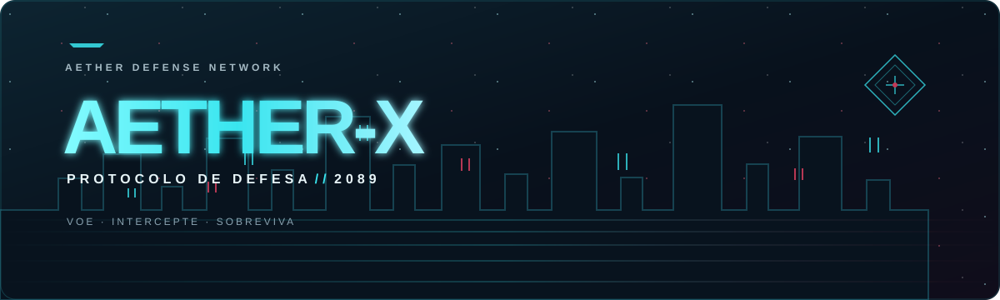

<div align="center">



### Jogo aeroespacial 3D em arquivo único HTML — 100% offline e sem dependências externas.

[**JOGAR AGORA · HTML OFFLINE**](AETHER-X-offline.html)

Campanha Cyberpunk · Operações Realistas · Mundos Abertos · Hangar & Upgrades · Vale da Cachoeira

</div>

---

## 🚀 Visão Geral do Jogo

O **AETHER-X** é um jogo completo de combate e simulação aeroespacial desenvolvido em Three.js e TypeScript, projetado para rodar diretamente do navegador sem necessidade de servidor ou conexão com a internet.

### Destaques
- **Dois Universos Visuais** (cenários, drones, armas e HUD):
  - **Natural / Tático**: biomas naturais, frota tática, munição balística (`R`), horizonte artificial e telemetria GPS.
  - **Cyberpunk**: cidade neon, esquadrões biomecânicos, escudo de plasma e canhões de pulso.
- **Dois Modelos de Voo Independentes do visual** (`FlightModel`):
  - **Arcade**: Voo responsivo, agilidade instantânea e mira assistida.
  - **Simulador**: Sustentação física, inércia de curva, ângulo de atitude e resposta a turbulência.
  - *O perfil arcade é o padrão nos dois universos; altere para simulador nas Configurações quando quiser.*
- **Câmera Dinâmica com Mira Desobstruída**:
  - Enquadramento inteligente que compensa manobras de mergulho, garantindo que o drone nunca obstrua o retículo central contra alvos.
- **Estabilização Ativa de Voo (GPS & Altitude Hold)**:
  - Sistema de controle de voo que anula ventos de até 21 km/h e freia ativamente a aeronave quando os controles são liberados.

---

## 🗺️ Modos de Jogo

### 1. Hub de Comando Central
O menu principal centraliza a experiência em três modos de navegação rápida:
1. **Campanha**: Progressão linear com setores desbloqueáveis e sistema de medalhas (Bronze, Prata, Ouro).
2. **Mundo Aberto**: Exploração livre em metrópoles com 8 tarefas dinâmicas por universo.
3. **Vale da Cachoeira**: Expedição de alta velocidade pelo desfiladeiro fluvial e cânion hidrotermal.

Ao selecionar qualquer modo, o jogador escolhe entre o universo **Natural / Tático** e o **Cyberpunk**. A escolha de voo (Arcade ou Simulador) fica separada nas Configurações e vale para ambos.

### 2. Campanhas
- **Campanha Cyberpunk (8 Missões)**:
  - 01 · Treinamento de Voo (Megacidade)
  - 02 · Interceptação Rápida (Perímetro Urbano)
  - 03 · Núcleo Sentinela (Chefe em 3 Fases)
  - 04 · Porto Industrial (Docas sob Chuva)
  - 05 · Corredor das Torres (Torres Solares em Altitude)
  - 06 · Desfiladeiro das Cataratas (Cânion com Snipers)
  - 07 · Zona de Sombra (Esquadrão Pesado Noturno)
  - 08 · Represa Hidroelétrica (Chefe Supremo Leviatã)
- **Campanha Realista (10 Operações)**:
  - Operações táticas com 7 biomas exclusivos (Serra da Neblina, Incêndio Florestal, Cânion Árido, Falésias Costeiras, Base Ártica, Refinaria Noturna, Porto Mercantil, Vale da Cachoeira, Vale Atlântico e Megaconstrução da Represa).
  - Objetivos avançados: resgate com hover de precisão, combate a incêndios florestais (`E`), transporte de carga e escolta de comboios.

### 3. Mundos Abertos
- **Neo-Aether (Cyberpunk)**: Megacidade com arranha-céus, anéis viários suspensos, helipontos e tráfego aéreo.
- **Vale Atlântico (Realista)**: Relevo da Mata Atlântica com colinas de até 42m, Farol Costeiro do Cabo com feixe giratório e Porto Mercantil com quebra-mar de 240m, navio cargueiro de 130m, guindastes de pórtico e pátio de contêineres coloridos.
- **HUD Retrátil**: Pressione `[TAB]` para compactar a lista de tarefas durante o voo e liberar a visibilidade.

---

## 🛸 Hangar, Upgrades & Economia

- **Catálogo de 8 Drones em 4 Tiers**:
  - *Realista*: DJI Mavic Tático (T1), Apex FPV Carbon 7" (T2), Goliath Hexacóptero Industrial (T3), Falcão VANT Militar (T4).
  - *Cyberpunk*: AETHER-X Mk.I (T1), Specter V-Wing (T2), Valkyrie Gunship (T3), Omega Singularity (T4).
- **Oficina Mecânica Exclusiva**:
  - 5 categorias de melhorias × 5 níveis por drone (Propulsão, Blindagem, Armamento, Bateria/Turbo, Aviônica/Carregador).
  - **Isolamento de Upgrades**: Peças compradas pertencem exclusivamente ao drone aprimorado.
  - **Curva de Overlap**: Um drone de Tier inferior totalmente melhorado supera o drone de fábrica do Tier seguinte.
- **Economia de Créditos (`CR$`)**:
  - Saldo compartilhado ganho por conclusão de missões, medalhas, pontuação e tarefas de mundo aberto.

---

## 🎮 Controles

| Tecla / Comando | Função |
| --- | --- |
| `W` / `S` | Acelerar à frente / Frear e recuar |
| `A` / `D` | Guinar (Yaw esquerda / direita) |
| `Espaço` / `C` | Subir / Descer (Empuxo vertical) |
| `Shift` | Turbo pós-combustão |
| `Clique esquerdo` / `F` | Disparar armamento frontal |
| `R` | Recarregar metralhadora traçante (Modo Realista) |
| `E` | Dispersão de água / Entrega de carga |
| `V` | Alternar câmera (Perseguição / Próxima) |
| `Tab` | Alternar lista de tarefas do Mundo Aberto (Expandida / Compacta) |
| `Esc` / `P` | Pausar ou retomar |

---

## 💻 Jogar Offline

Abra o arquivo **[`AETHER-X-offline.html`](AETHER-X-offline.html)** em qualquer navegador desktop moderno (Chrome, Edge, Firefox, Brave, Safari).
O pacote contém a engine Three.js, shaders procedurais, geometria 3D, áudio sintetizado e estilos unificados em apenas **792 KB**, sem necessitar de internet ou downloads externos.

---

## 🛠️ Desenvolvimento e Validação

Requer **Node.js 20+** e **pnpm**.

```powershell
pnpm install
pnpm dev             # Servidor de desenvolvimento Vite
pnpm typecheck       # Validação estática TypeScript (tsc --noEmit)
pnpm test            # Bateria automatizada de testes de invariantes
pnpm build           # Compilação e empacotamento offline
pnpm verify:offline  # Validação de integridade 100% autônoma
```

Para exibir o diagnóstico de FPS durante o desenvolvimento, abra `http://127.0.0.1:5173/?perf`.
